# Lab 01 - Ubuntu Server Setup

## Objective

Deploy an Ubuntu Server 26.04.1 LTS virtual machine on Proxmox VE with a static IP, DNS pointing to the Active Directory domain controller, current security patches, correct time, and a working QEMU guest agent.

## Environment

| Component | Details |
|---|---|
| Hypervisor | Proxmox VE on Dell OptiPlex 7060 (i5-8500, 24 GB RAM) |
| VM | LNX01, VM ID 200 - 2 vCPU (type host), 2 GB RAM, 32 GB disk on `local-lvm` |
| OS | Ubuntu Server 26.04.1 LTS (kernel 7.0) |
| IP / Gateway | 192.168.100.20/24 / 192.168.100.1 |
| DNS | 192.168.100.10 (DC01), search domain `homelab.local` |

VM IDs: 100s for Windows, 200s for Linux, so the OS is clear from the number.

## Steps

### 1. Download and verify the ISO

I downloaded the ISO straight into Proxmox storage with **Download from URL** and pasted the SHA-256 hash from the official `SHA256SUMS` file. Proxmox verified the file automatically and would have rejected a corrupted or tampered download.

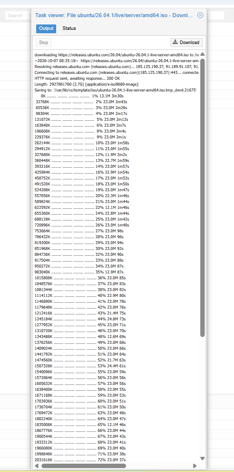
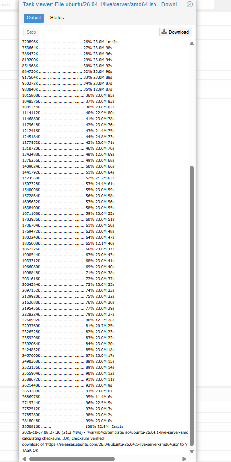

### 2. Create the VM

VirtIO SCSI single controller, VirtIO NIC, q35 machine, SeaBIOS, QEMU agent enabled, Discard and IO thread on, CPU type `host`. Unlike Windows Server, Linux includes VirtIO drivers in the kernel, so no driver ISO was needed.

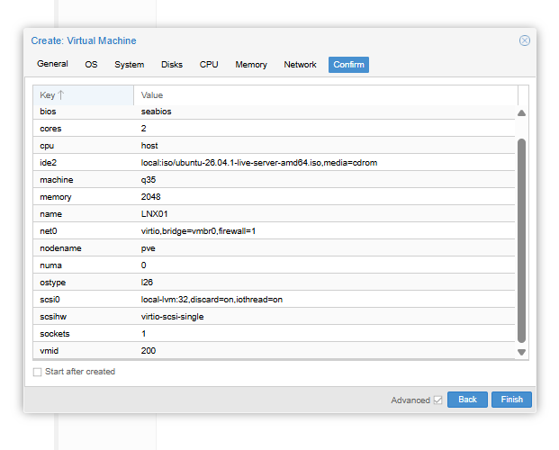
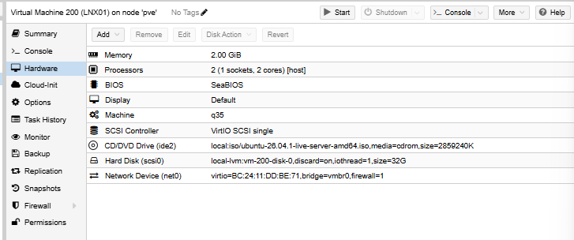

### 3. Install Ubuntu Server

- **Checked the IP was free first.** `Test-Connection 192.168.100.20` returned `DestinationHostUnreachable`: no device answered ARP, so no device held that address. (A firewall can block ping, but not ARP.)
- **Static IPv4** with DNS on DC01, to prepare a future Active Directory domain join.

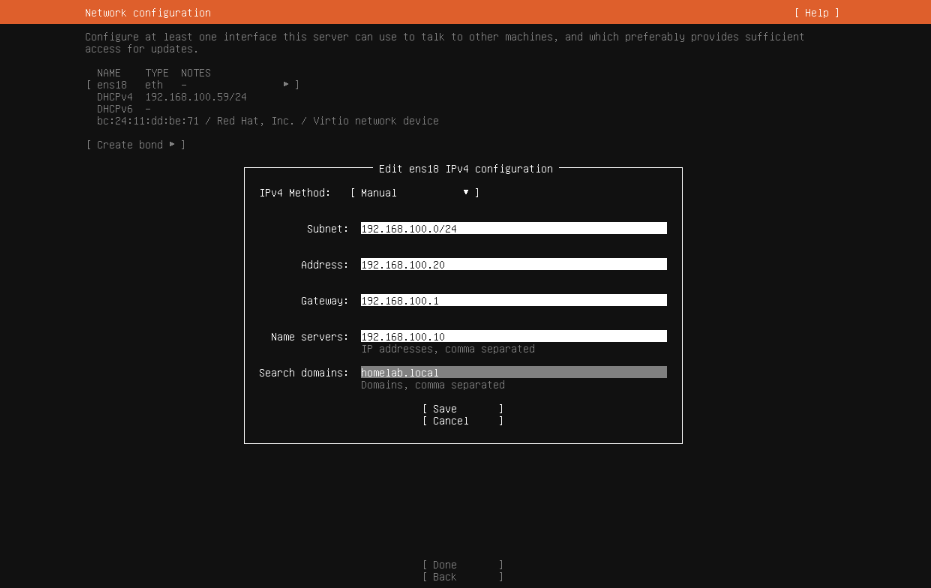
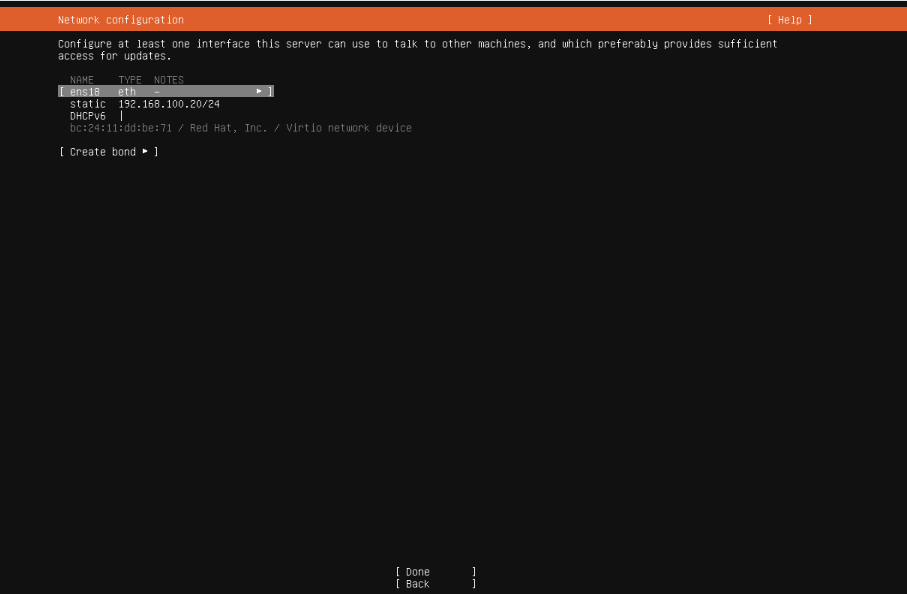

- **Mirror test passed.** This one check proved the gateway, DNS and the DC01 forwarders all work.

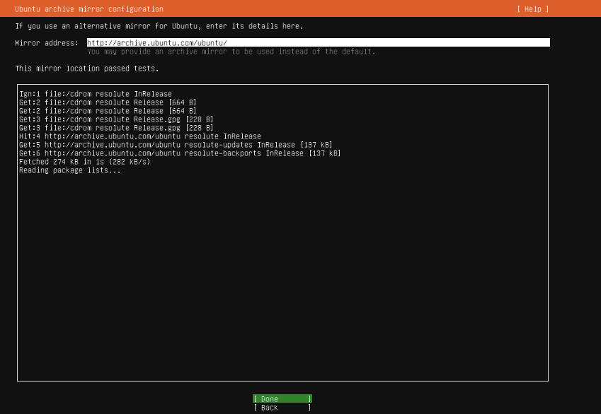

- **Storage:** default LVM layout. The installer gave `/` only 15 GB of the 30 GB volume group. I left it on purpose for [Lab 05](../Lab05-Incident-Disk-Full/).
- **Profile and SSH:** hostname `lnx01`, OpenSSH server installed, no snaps.

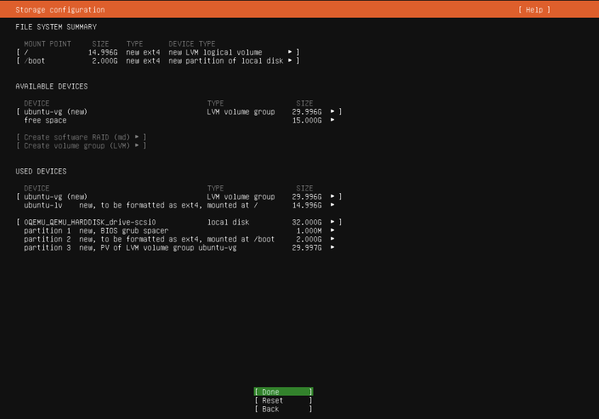
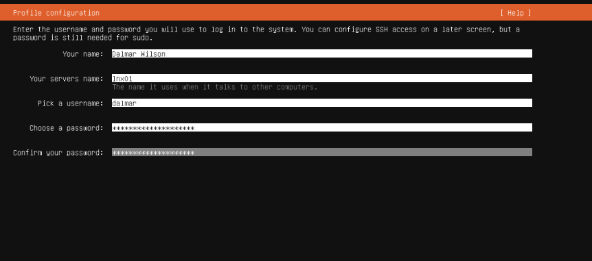
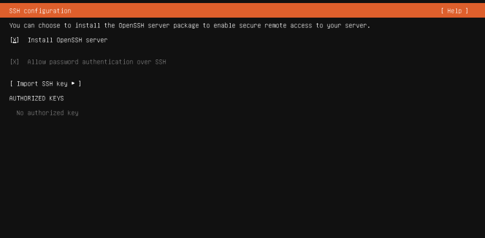

### 4. First boot and verification

The first login shows the IP, the 14.66 GB root filesystem and the SSH host key fingerprint.

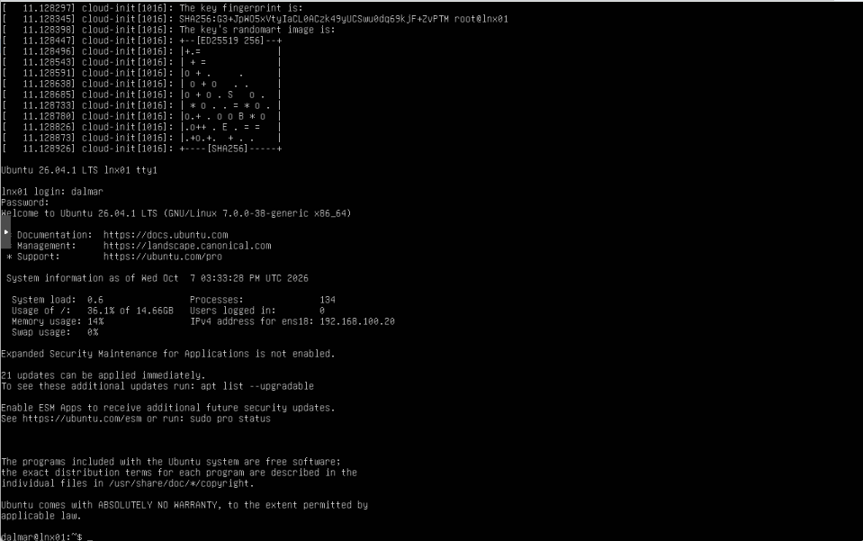

```bash
hostnamectl
ip -br a
ip route                          # default via 192.168.100.1 ... proto static
resolvectl status ens18           # DNS 192.168.100.10, domain homelab.local
ping -c 3 192.168.100.10
resolvectl query dc01.homelab.local
lsblk
sudo vgs                          # VFree 15.00g
```

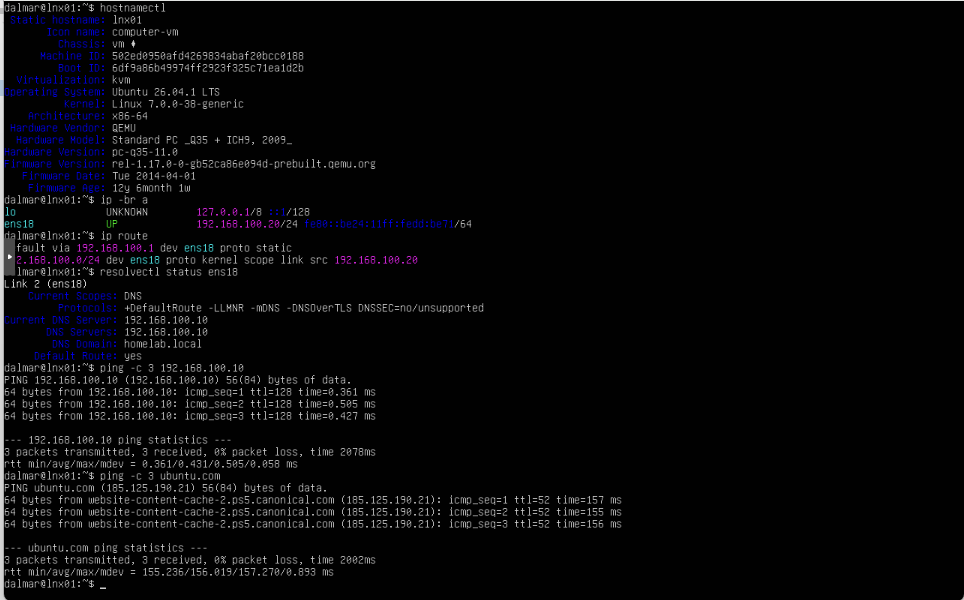
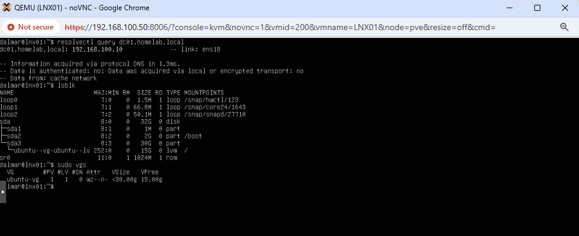

DC01 answered pings with TTL 128 (Windows default); Linux hosts start at 64.

### 5. Troubleshooting: packet loss

The first ping to `ubuntu.com` lost 2 of 3 packets. I isolated it by layers:

| Target | Loss | Average |
|---|---|---|
| Gateway 192.168.100.1 | 0% | ~0.8 ms |
| 1.1.1.1 (internet, no DNS) | 0% | ~43 ms |

The local network was healthy, and a repeat test to `ubuntu.com` showed 0% loss. The loss came from the CDN, not from my network.

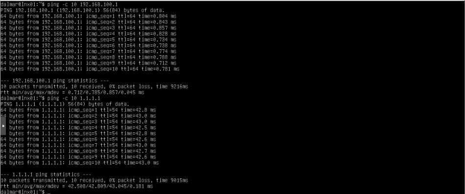

### 6. Updates and QEMU guest agent

```bash
sudo apt update && sudo apt upgrade -y
sudo apt install -y qemu-guest-agent
sudo systemctl start qemu-guest-agent
```

The agent is a "static" systemd unit: it starts when the virtual device is present, so it needs no `enable`. I rebooted to confirm it starts on its own.

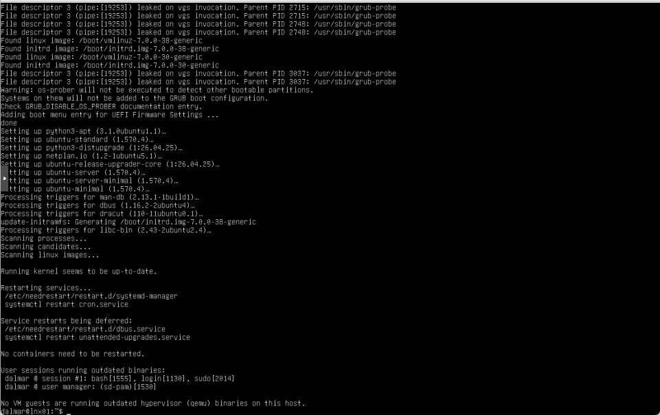
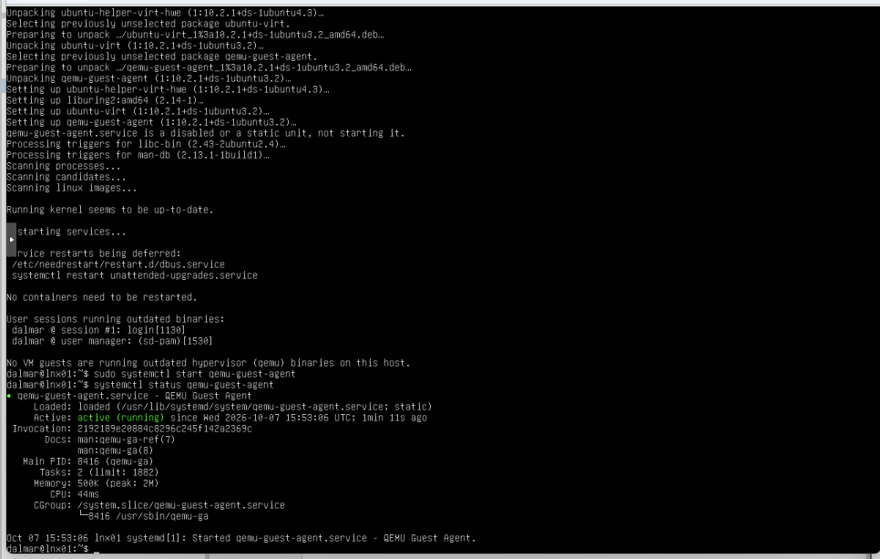
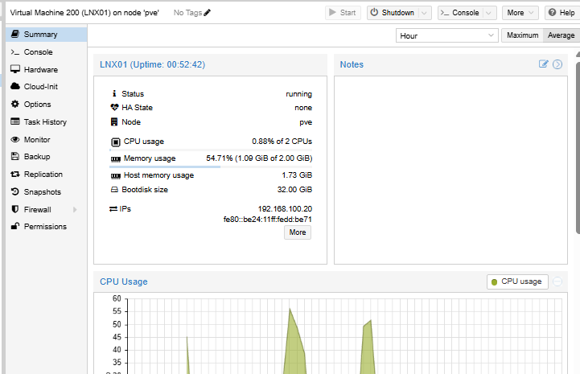
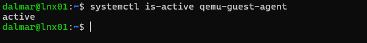

### 7. Timezone and NTP

The server was on UTC, six hours off from local time. Matching time matters for correlating logs with DC01, and Kerberos rejects clocks that differ by more than 5 minutes.

```bash
sudo timedatectl set-timezone America/Costa_Rica
timedatectl                       # System clock synchronized: yes
```

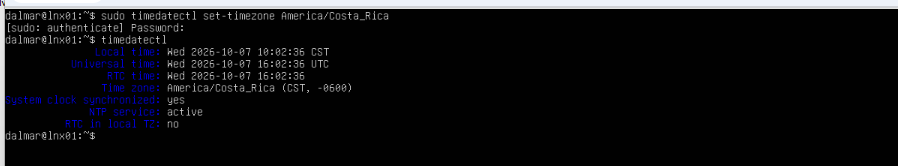

## Verification

| Check | Result |
|---|---|
| ISO integrity | SHA-256 verified by Proxmox |
| Static IP | `proto static`, address survives reboot |
| DNS | `dc01.homelab.local` resolves to 192.168.100.10 |
| Internet | 0% loss to gateway and 1.1.1.1 |
| Patches | 0 updates pending |
| Guest agent | `active` after reboot, IP visible in Proxmox |
| Time | America/Costa_Rica, NTP synchronized |

## What I learned

- `DestinationHostUnreachable` on a LAN means no ARP reply, which is stronger evidence than a ping timeout.
- `apt update` only refreshes the package list; `apt upgrade` installs.
- A change is not finished until it survives a reboot.
- Troubleshoot by layers: the closest hop first, then farther out.

## Commands reference

```bash
hostnamectl; ip -br a; ip route; resolvectl status ens18
resolvectl query dc01.homelab.local
lsblk; sudo vgs
sudo apt update && sudo apt upgrade -y
sudo apt install -y qemu-guest-agent
systemctl is-active qemu-guest-agent
sudo timedatectl set-timezone America/Costa_Rica
```
