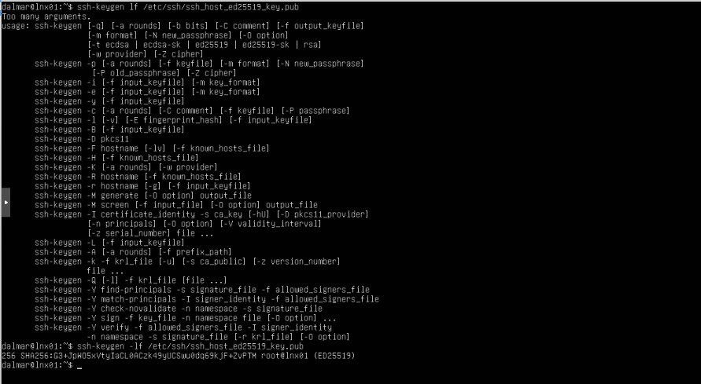
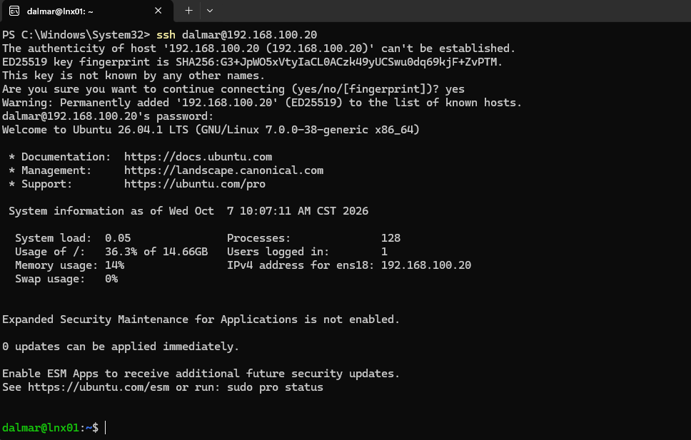
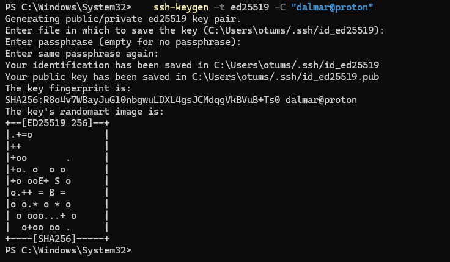
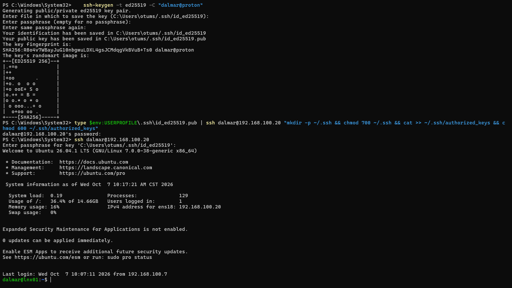
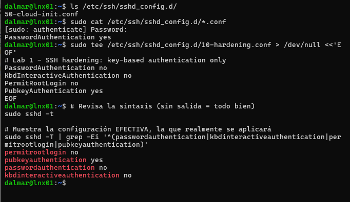
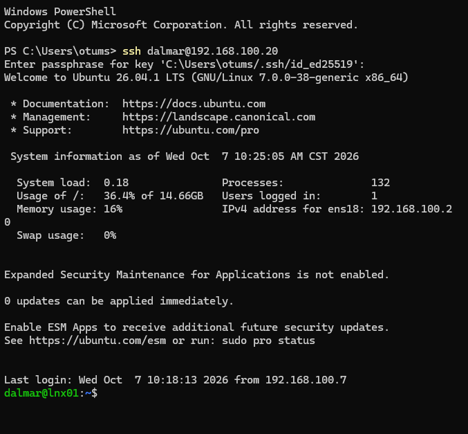
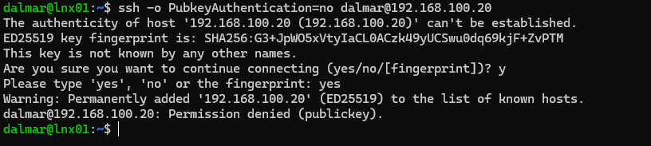
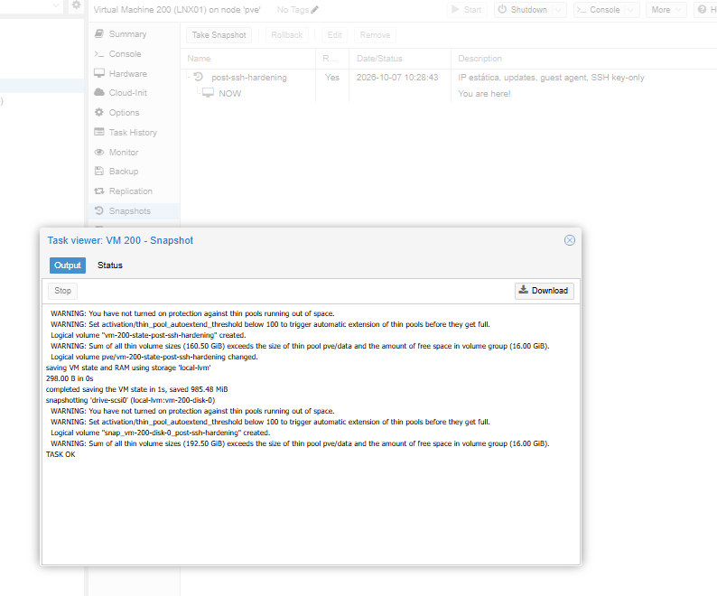

# Lab 02 - SSH Hardening

## Objective

Allow SSH access to LNX01 only with an Ed25519 key, disable password and direct root login, and verify the server's identity before trusting it.

## Environment

| Component | Details |
|---|---|
| Server | LNX01 - Ubuntu Server 26.04.1, 192.168.100.20 |
| Client | Windows 11 desktop (OpenSSH client), 192.168.100.7 |

## Steps

### 1. Verify the server's host key

Before typing `yes` on the first connection, I compared the fingerprint SSH showed me with the one on the server. They matched, so I knew I was connecting to LNX01 and not to a man-in-the-middle. The fingerprint is now stored in `known_hosts`.

```bash
ssh-keygen -lf /etc/ssh/ssh_host_ed25519_key.pub
```




### 2. Create a key pair on the client

```powershell
ssh-keygen -t ed25519 -C "dalmar@proton"
```

The private key stays on the client and is protected by a passphrase. Only the public key goes to the server.



### 3. Copy the public key and test it

Windows has no `ssh-copy-id`, so I piped the key over SSH and set the permissions SSH requires (700 on `.ssh`, 600 on `authorized_keys`):

```powershell
type $env:USERPROFILE\.ssh\id_ed25519.pub | ssh dalmar@192.168.100.20 "mkdir -p ~/.ssh && chmod 700 ~/.ssh && cat >> ~/.ssh/authorized_keys && chmod 600 ~/.ssh/authorized_keys"
```

Proof the key worked: SSH asked for the **key passphrase**, not the server password.



### 4. Disable passwords - and avoid the precedence trap

The installer created `/etc/ssh/sshd_config.d/50-cloud-init.conf` with `PasswordAuthentication yes`. In sshd, **the first value read wins**, and drop-in files load in alphabetical order. A file named `99-hardening.conf` would be silently ignored. I named mine `10-hardening.conf`:

```
PasswordAuthentication no
KbdInteractiveAuthentication no
PermitRootLogin no
PubkeyAuthentication yes
```

I checked the syntax with `sshd -t` and the **effective** configuration with `sshd -T` before restarting SSH, and kept my existing session open as a safety net.



### 5. Verify

```powershell
ssh dalmar@192.168.100.20                              # key: works
ssh -o PubkeyAuthentication=no dalmar@192.168.100.20   # password: denied
```




### 6. Snapshot before the next risky change

The next lab configures a firewall, which can lock out SSH, so I took a Proxmox snapshot first.



## Verification

| Check | Result |
|---|---|
| Host key | Fingerprint matched before first connection |
| Key login | Prompts for key passphrase |
| Password login | `Permission denied (publickey)` |
| Effective config | `passwordauthentication no`, `permitrootlogin no`, `pubkeyauthentication yes` |

## Troubleshooting and mistakes

- I first ran `ssh-keygen` inside the SSH session (prompt `dalmar@lnx01`). I cancelled with Ctrl+C: the private key belongs on the client, not the server.
- I then pasted the next command into ssh-keygen's "file path" question. Interactive tools need each question answered before pasting more.

## What I learned

- Always read the prompt to know which machine you are on.
- `sshd -T` shows what sshd will really use; a config file alone does not prove anything.
- Test the new access method before removing the old one.
- `ssh.service` shows `disabled` on Ubuntu because `ssh.socket` starts it on demand (socket activation).
- The auth log records who logged in, from which IP, and the fingerprint of the key used.

## Commands reference

```bash
ssh-keygen -lf /etc/ssh/ssh_host_ed25519_key.pub
ls /etc/ssh/sshd_config.d/
sudo sshd -t
sudo sshd -T | grep -Ei '^(passwordauthentication|kbdinteractiveauthentication|permitrootlogin|pubkeyauthentication)'
sudo systemctl restart ssh
```
