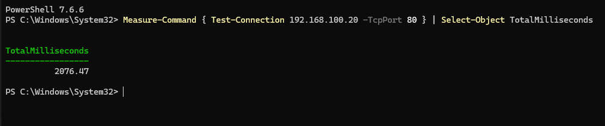
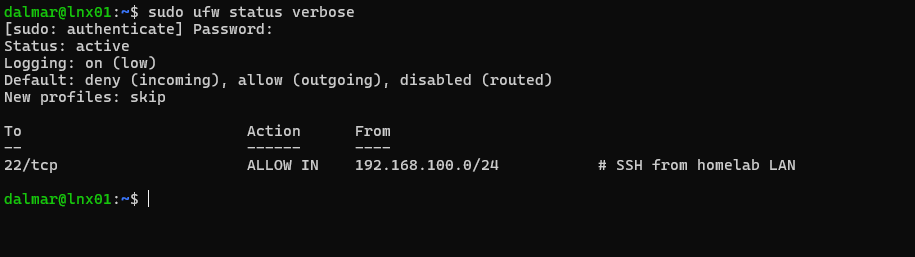
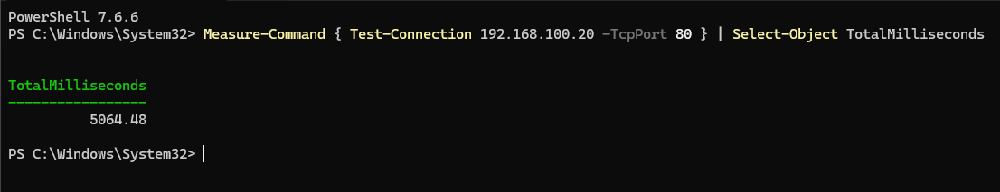
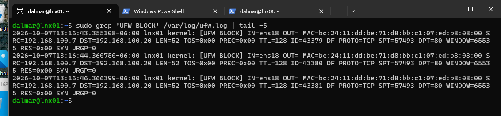

# Lab 03 - Firewall with UFW

## Objective

Block all incoming traffic to LNX01 except SSH from the local network, log blocked packets, and measure the difference between a closed and a filtered port.

## Environment

| Component | Details |
|---|---|
| Server | LNX01 - Ubuntu Server 26.04.1, 192.168.100.20 |
| Test client | Windows 11 desktop with PowerShell 7, 192.168.100.7 |

## Steps

### 1. Baseline: port 80 with the firewall off

```powershell
Measure-Command { Test-Connection 192.168.100.20 -TcpPort 80 } | Select-Object TotalMilliseconds
```



### 2. Configure and enable UFW

The SSH rule goes **before** `enable`; otherwise "deny incoming" would cut my own session.

```bash
sudo ufw default deny incoming
sudo ufw default allow outgoing
sudo ufw allow from 192.168.100.0/24 to any port 22 proto tcp comment 'SSH from homelab LAN'
sudo ufw logging on
sudo ufw enable
sudo ufw status verbose
```

SSH is limited to the LAN (least privilege at the network level): even a stolen key is useless from outside the network.



### 3. Same test with the firewall on



| State | Time | What happened |
|---|---|---|
| UFW off - port **closed** | 2,076 ms | Linux answered each SYN with RST. Windows retries after an RST, which adds up to ~2 s |
| UFW on - port **filtered** | 5,064 ms | Packets were dropped silently; the client waited for its 5 s timeout |

A closed port answers; a filtered port stays silent. This is the same difference `nmap` reports as *closed* vs *filtered*.

### 4. Read the block log

```bash
sudo grep 'UFW BLOCK' /var/log/ufw.log | tail -5
```



| Evidence | Meaning |
|---|---|
| Same source port (57493) on all three lines | One connection attempt, retransmitted |
| Gaps of 1 s, then 2 s | TCP exponential backoff |
| TTL 128, WINDOW 65535 | Typical Windows sender (passive fingerprinting) |
| `MAC=` field | Destination MAC, source MAC, and `08:00` (IPv4) |
| Timestamp `-06:00` | Local time, thanks to the timezone set in Lab 01 |

Only the second test appears: UFW was off during the first. A system only keeps evidence of what it was configured to record.

## Troubleshooting and mistakes

- `Test-Connection -TcpPort` failed in Windows PowerShell 5.1: the parameter only exists in PowerShell 7.
- I once ran the PowerShell command inside LNX01 (`command not found`).
- I expected the closed-port test to take milliseconds; it took ~2 s because of Windows retry behavior, not Linux.

## What I learned

- Measure instead of guessing: `Measure-Command` turned "it felt a bit slow" into numbers.
- Repeated SYNs with the same source port are retransmissions, not new connections.
- Behavior (timing, TTL, window size) can tell a normal client from a port scanner.

## Commands reference

```bash
sudo ufw status verbose
sudo ufw status numbered
sudo ufw disable / sudo ufw enable
sudo grep 'UFW BLOCK' /var/log/ufw.log | tail
```
