# Lab 04 - Users, Permissions and Sudo

## Objective

Create department users and groups, give each department a private shared folder where teammates can edit each other's files, and delegate limited sudo rights to IT following least privilege.

## Environment

| User | Department group | Shared folder |
|---|---|---|
| mario | lnx-it | /srv/shared/it |
| elena | lnx-sales | /srv/shared/sales |
| diego | lnx-hr | /srv/shared/hr |

Local names and the `lnx-` prefix are different from my Active Directory users on purpose: after a domain join, a local account with the same name as a domain account would hide it.

## Steps

### 1. Users and groups

```bash
sudo groupadd lnx-it; sudo groupadd lnx-sales; sudo groupadd lnx-hr
sudo useradd -m -s /bin/bash -c "Mario Solis - IT" -G lnx-it mario
sudo useradd -m -s /bin/bash -c "Elena Castro - Sales" -G lnx-sales elena
sudo useradd -m -s /bin/bash -c "Diego Rojas - HR" -G lnx-hr diego
```

UID and GID numbers are independent counters (mario is uid 1001, gid 1004). Home folders are `750`, so users cannot read each other's homes.

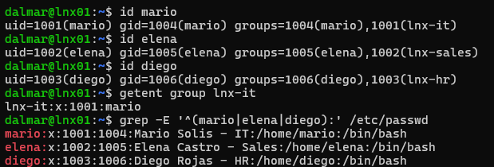
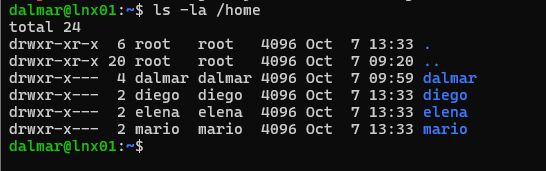

### 2. Shared folders with setgid

```bash
sudo mkdir -p /srv/shared/{it,sales,hr}
sudo chown root:lnx-it /srv/shared/it      # same for sales and hr
sudo chmod 2770 /srv/shared/{it,sales,hr}
```

`770` gives the group full access and others none. The leading `2` is **setgid**: new files inherit the folder's group instead of the creator's personal group.

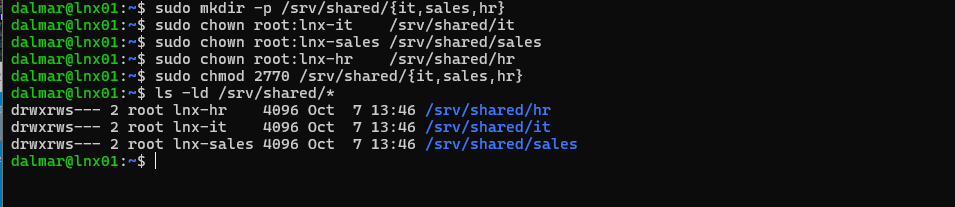
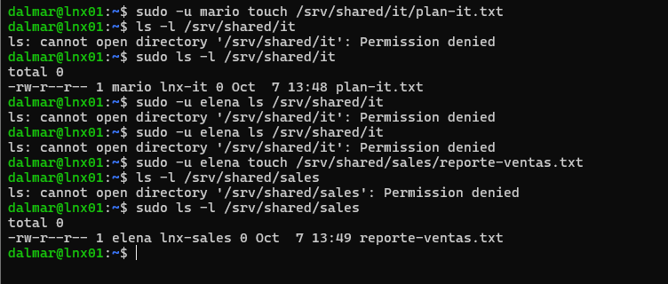

I proved setgid by removing it, creating a file, and restoring it: `sin-setgid.txt` got group `diego`, `con-setgid.txt` got `lnx-hr`.

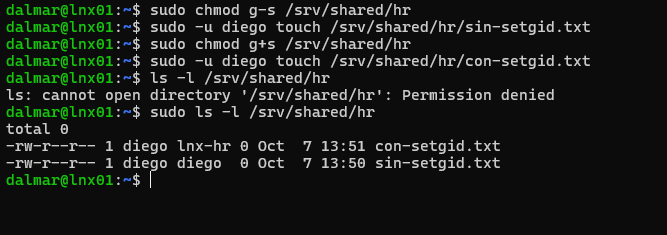

### 3. Fix the umask problem with a default ACL

Files were still born `-rw-r--r--`: the default umask (022) removed group write, so teammates could read but not edit. A default ACL overrides the umask for new files. `setfacl` was missing, so I installed the `acl` package first.

```bash
sudo apt install -y acl
sudo setfacl -d -m g::rwx,o::--- /srv/shared/{it,sales,hr}
```

New files are now born `-rw-rw----`. Existing files keep their old permissions.

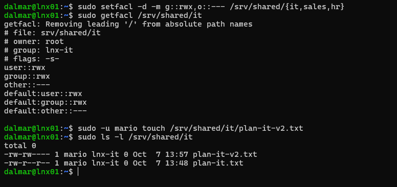

To test real collaboration I added myself to `lnx-it`. The `-a` is critical: without it, `usermod -G` replaces all groups and would remove me from `sudo`.

```bash
sudo usermod -aG lnx-it dalmar
```

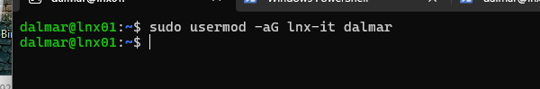
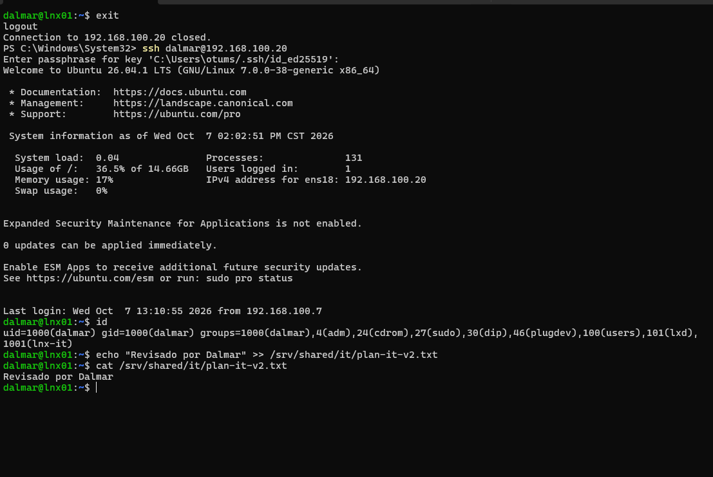

### 4. Delegated sudo for IT

Created with `sudo visudo -f /etc/sudoers.d/lnx-it` (visudo checks syntax; a broken sudoers file can break sudo for everyone):

```
%lnx-it ALL=(root) /usr/bin/apt update, /usr/bin/systemctl restart ssh, /usr/bin/systemctl --no-pager status ssh
```

Exact arguments matter. Many commands can open a root shell when run with sudo (see GTFOBins): `systemctl status` opens a pager, and `!sh` inside `less` gives a root shell. `--no-pager` removes that path, and exact arguments block extra options such as `apt -o ...`.

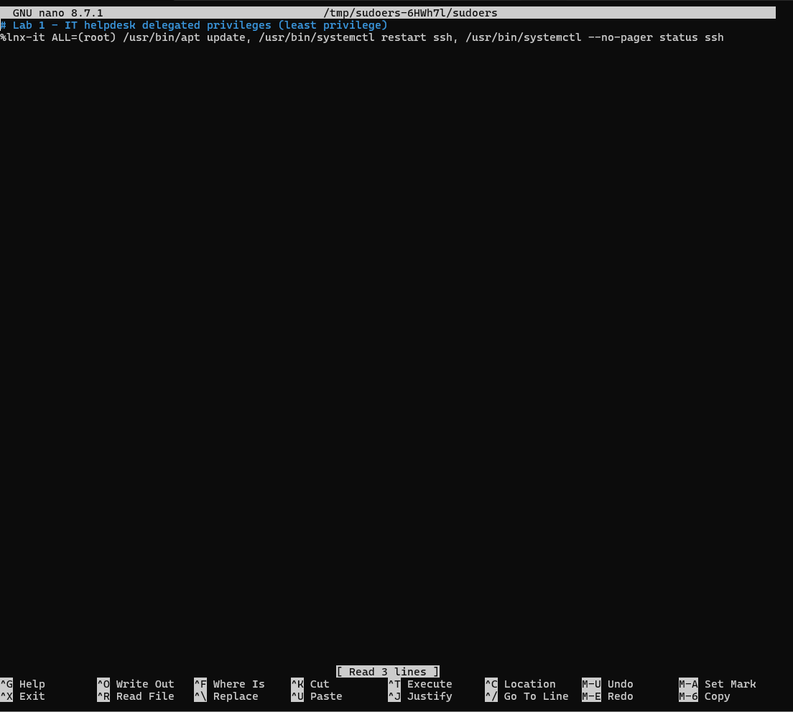
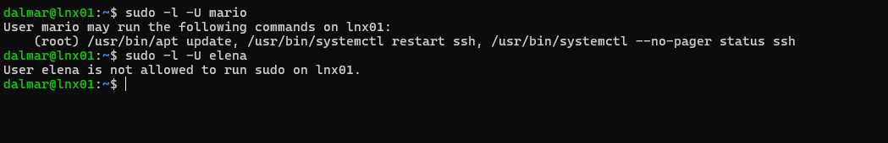
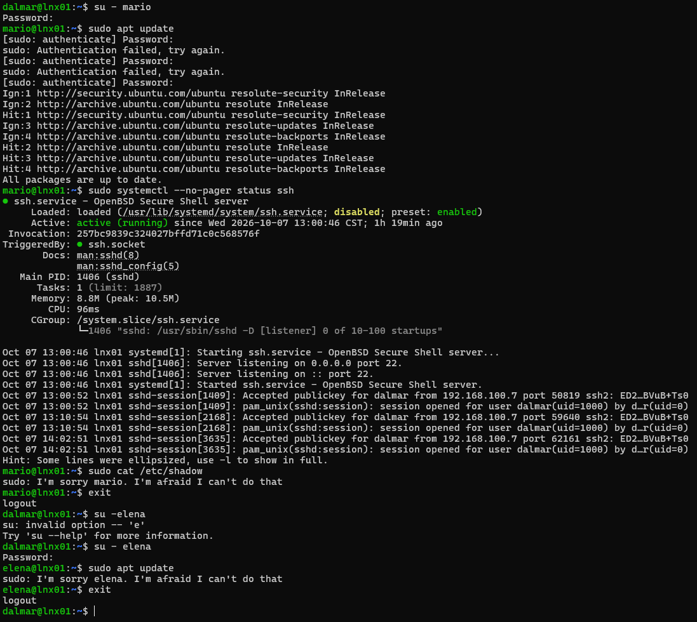
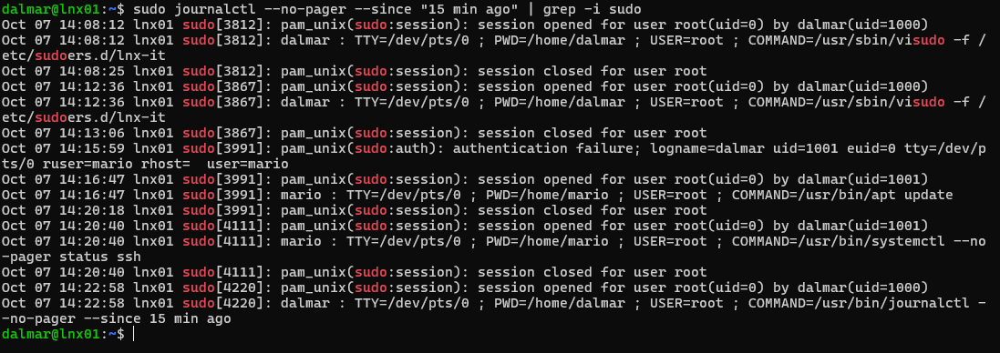

## Finding: audit gap with sudo-rs (observed in this lab)

Ubuntu 26.04 ships `sudo-rs` as the default sudo. In my tests, allowed commands and password failures were logged, but the **denied** attempts (mario running `sudo cat /etc/shadow`, elena running `sudo apt update`) left no entry in the journal. I confirmed it by reading the full, unfiltered journal for that time window.

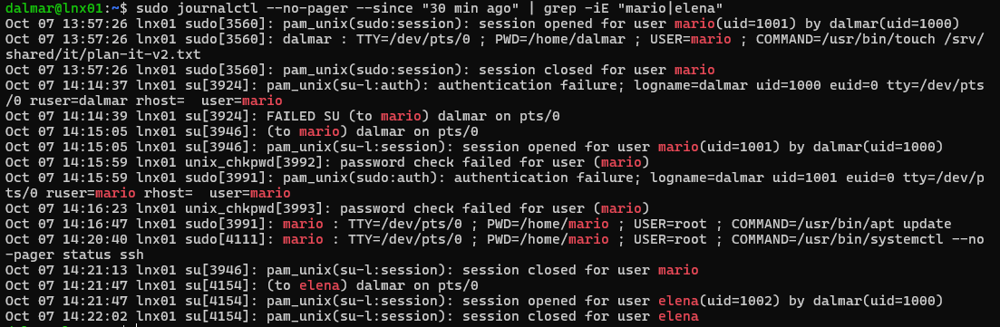
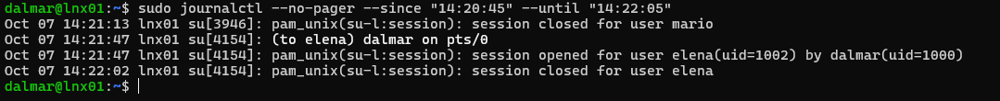

**Why it matters:** an attempt to read `/etc/shadow` is a classic sign of privilege-escalation reconnaissance. Without a log entry, those attempts are invisible. Classic sudo logs denials ("command not allowed") through its `log_denied` setting.

**Status:** observed on Ubuntu 26.04.1 with sudo-rs in this lab. Not yet confirmed with a control test using classic sudo. **Possible mitigation:** `auditd` rules on `execve` and on sensitive files.

## Troubleshooting and mistakes

- Forgot `sudo` on `ls` of the shared folders: even the admin is "others" there and must request access with sudo.
- Typed the wrong password for `sudo` as mario: sudo asks for the **current user's** password.
- Typed `su -elena` instead of `su - elena`.
- I expected the denied sudo attempts to be logged; the evidence showed they were not.

## What I learned

- setgid controls the group of new files; the umask and ACLs control their permissions.
- Use `usermod -aG`, never `usermod -G`, to add a group.
- Delegate exact commands with exact arguments, never whole binaries.
- The journal kept `logname=dalmar` even after `su` to mario, so the real person stays traceable.
- Membership in the `lxd` group is effectively root-equivalent: a finding on a regular user.

## Commands reference

```bash
id mario; getent group lnx-it
ls -ld /srv/shared/*; sudo getfacl /srv/shared/it
sudo -l -U mario
sudo journalctl --no-pager --since "15 min ago" | grep -i sudo
```
