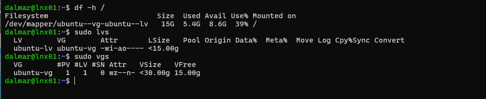
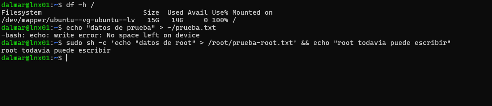
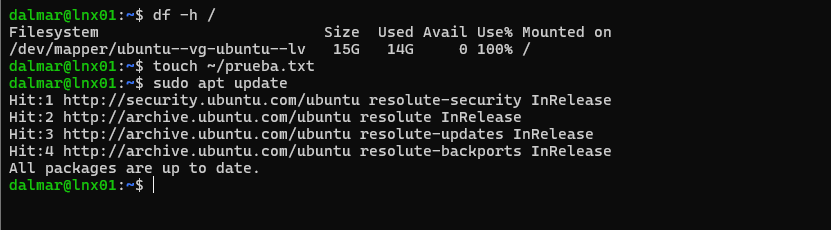
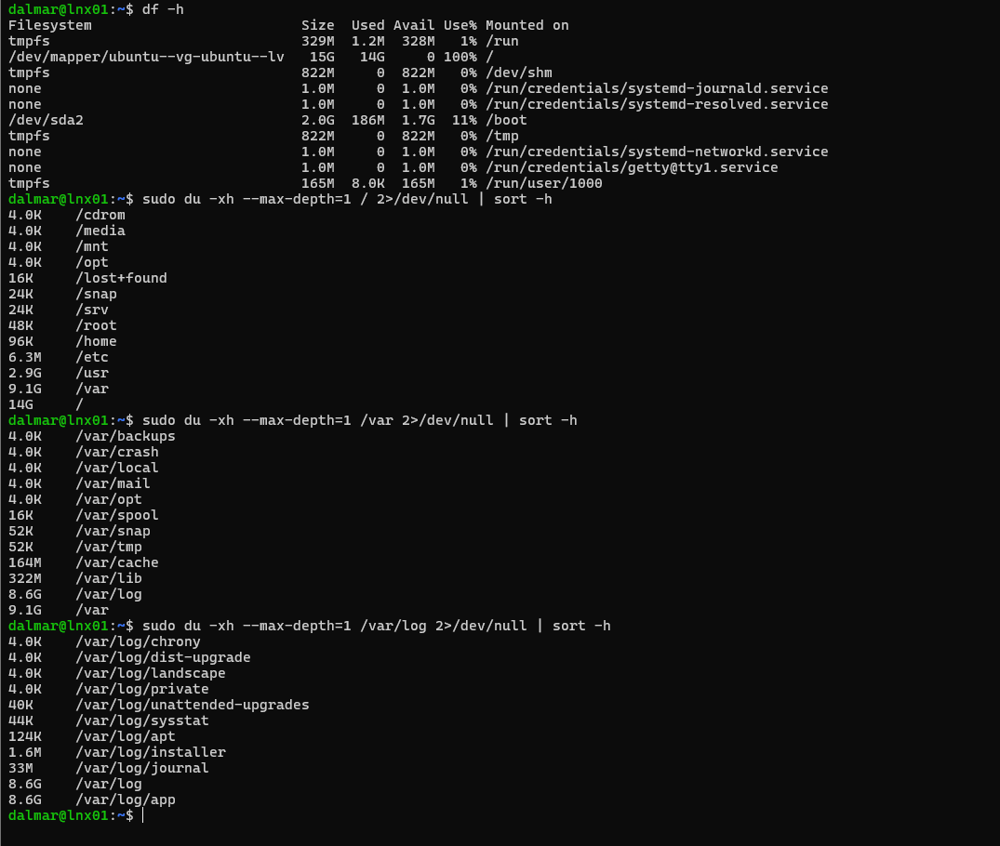
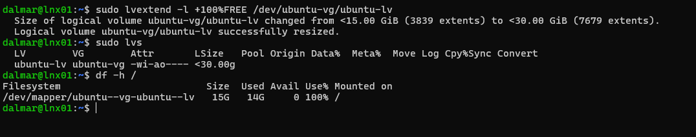
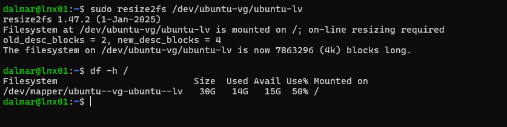
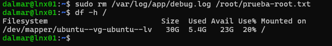

# Lab 05 - Incident: Disk Full

## Objective

Simulate a full root filesystem, diagnose it like a support or NOC ticket, restore service by extending LVM storage online without downtime, and remove the root cause.

**Ticket:** "Users can't save files and the system won't install updates."

## Environment

| Layer | Before | After |
|---|---|---|
| Volume group `ubuntu-vg` | 30 GB, 15 GB free | 30 GB, 0 free |
| Logical volume `ubuntu-lv` | 15 GB | 30 GB |
| `/` usage | 100% (during incident) | 20% |

Storage stack: disk `sda` -> partition `sda3` -> physical volume -> volume group `ubuntu-vg` -> logical volume `ubuntu-lv` -> ext4 -> mounted at `/`.

## Steps

### 1. Baseline



### 2. Break it: simulate a runaway log

```bash
sudo mkdir -p /var/log/app
AVAIL=$(df --output=avail -B1 / | tail -1)
sudo fallocate -l $AVAIL /var/log/app/debug.log
```

I used `fallocate` instead of `dd`: it reserves blocks without writing data, so it did not consume real space in the Proxmox thin pool.

### 3. Symptoms



- `/` at 100%, 0 available.
- A regular user writing content: `No space left on device`.
- Root could still write: ext4 reserves 5% of blocks for root so the admin can repair the system.

**Unexpected result:** `touch` and `apt update` still worked at 100%. An empty file needs an inode, not data blocks, and `apt` runs as root with nothing new to download. If a user says "I could create a file, so the disk isn't full", this is why.



### 4. Diagnosis: from general to specific

```bash
df -h
sudo du -xh --max-depth=1 / 2>/dev/null | sort -h
sudo du -xh --max-depth=1 /var 2>/dev/null | sort -h
sudo du -xh --max-depth=1 /var/log 2>/dev/null | sort -h
```

Trail: `/` (14 GB) -> `/var` (9.1 GB) -> `/var/log` (8.6 GB) -> `/var/log/app` (8.6 GB).



### 5. Restore service: extend the volume online

Growing the logical volume does **not** grow the filesystem inside it. I did it in two steps to show the difference:

```bash
sudo lvextend -l +100%FREE /dev/ubuntu-vg/ubuntu-lv   # LV is 30 GB, df still shows 15 GB
sudo resize2fs /dev/ubuntu-vg/ubuntu-lv               # ext4 grows while mounted
```

In daily work, `lvextend -r` does both steps at once.




### 6. Verify and remove the root cause

```bash
echo "datos de prueba" > ~/prueba.txt && cat ~/prueba.txt
sudo rm /var/log/app/debug.log
df -h /
```




## Verification

| Check | Result |
|---|---|
| Writes as a regular user | Work again |
| Filesystem size | 30 GB |
| Usage after cleanup | 20% |
| Downtime | None |

## What I learned

- Restore service first, then fix the root cause.
- `df` says which filesystem is full; `du` says what filled it.
- LVM has layers: extending the LV is not enough, the filesystem must grow too.
- A file deleted while a process still has it open does not free space (find it with `lsof +L1`). That is my next practice scenario.

## Commands reference

```bash
df -h /
sudo du -xh --max-depth=1 / 2>/dev/null | sort -h
sudo lvs; sudo vgs
sudo lvextend -r -l +100%FREE /dev/ubuntu-vg/ubuntu-lv
```
